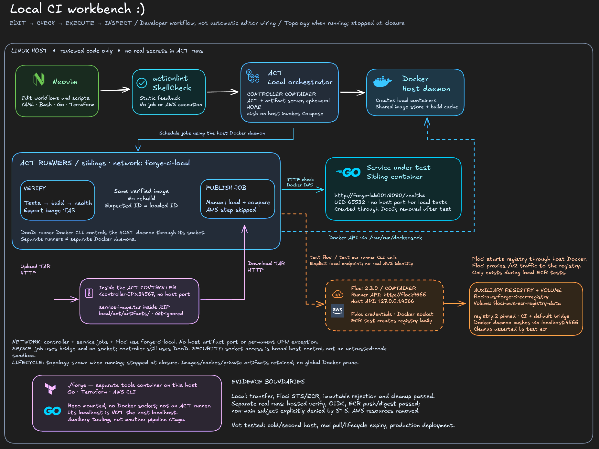
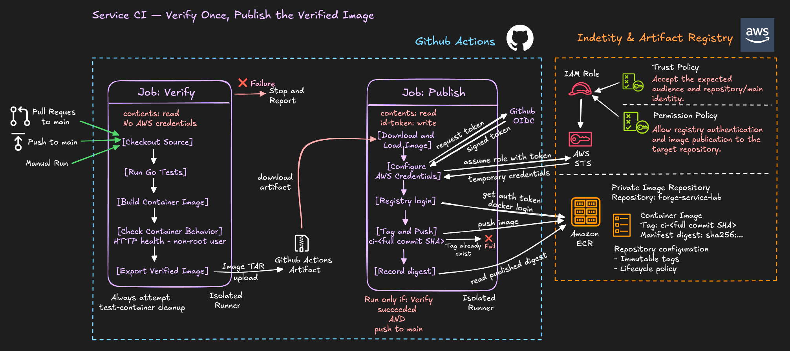
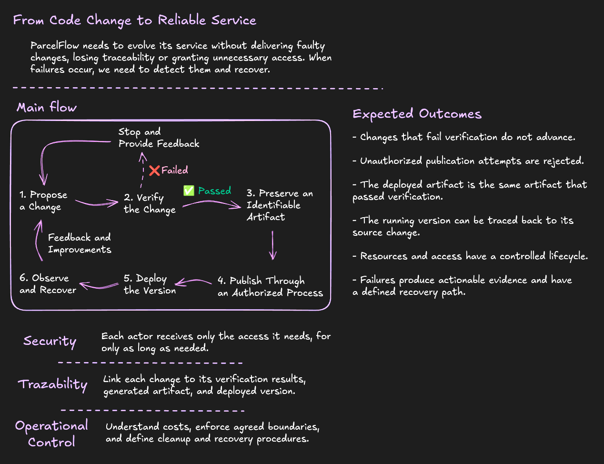

# AWS Ops Forge

**Build the delivery pipeline. Test its boundaries. Learn to operate what comes next.**

A hands-on AWS/DevOps learning project built around **ParcelFlow**, a fictional
shipment-event service. A small Go application evolves through delivery,
infrastructure, security and operations challenges—with evidence, not just recipes.

**Go · Terraform · GitHub Actions · Docker · ACT · Floci · AWS**

## What this project is for

- Refresh AWS knowledge and develop practical DevOps and platform-engineering skills.
- Build reproducible environments, test failure paths and make access boundaries explicit.
- Prepare for **DOP-C02** through progressively connected engineering problems.

## The local CI workbench

Develop the pipeline locally before spending a real integration run on it.



**Implemented:** ACT and its artifact server share an ephemeral controller container;
runners, the test service and Floci communicate over a dedicated Docker network.
Floci's ECR integration supports local push, digest and immutable-tag tests.

The workbench provides linting, execution, positive/negative tests and scoped
cleanup. It uses Docker-outside-of-Docker: **trusted code only**, not a sandbox.
The separate `forge` tools container provides interactive Go, Terraform and AWS CLI.

<details>
<summary><strong>Run the local checks</strong> — Linux amd64, Docker Engine/Compose and Bash</summary>

From the repository root, with no conflicting local test resources:

```sh
bash tools/ci/ci.sh build
bash tools/ci/ci.sh up
bash tools/ci/ci.sh test transfer
bash tools/ci/ci.sh test ecr
bash tools/ci/ci.sh down
```

The tools build can take several minutes. Downloads need network access; images
and caches are retained. These commands target local tests, not real AWS.
See the [workbench guide](tools/ci/README.md) for prerequisites, smoke checks,
individual commands and cleanup limits. Another-host/cold-install reproduction
has not yet been demonstrated.

</details>

## First delivery slice: from code to a trusted artifact

**Labs 001–003 are one progression**, not three unrelated demos:

**Test the Go service → define its registry with IaC → publish the verified image with temporary identity.**



The image is built once, tested, transferred between jobs and published to ECR
without rebuilding. GitHub OIDC replaces persistent AWS keys; the role trusts the
exact authorized subject. Tags are immutable and publication records the digest.
The full publication route is shown; manual service runs stop at load/compare.

| Demonstrated | Still outside this slice |
|---|---|
| Hosted tests/build and verified-image transfer | Application deployment and rollback |
| Real OIDC/ECR publication and rejected non-main role assumption | Full production security and concurrency hardening |
| Local ACT/Floci integration and negative tests | Complete AWS/emulator equivalence |
| Scoped Terraform create, repair, readback and teardown | Multi-environment or second-host portability proof |

Start with the [registry design](labs/002-image-registry/README.md),
[publication challenge](labs/003-ci-image-publish/README.md) or
[progress and evidence index](learning/PROGRESS.md). Deployment is a future step;
the next lab's scope and numbering are not yet fixed.

## The bigger picture



This is the **target system**, not a claim that every stage is implemented.
The next challenges will connect delivery to operation: controlled deployments,
observability, failure response and recovery. The [roadmap](docs/ROADMAP.md) follows
demonstrated competency rather than a calendar.

## Explore and work safely

| Area | Entry point |
|---|---|
| Lab workflow and session shortcuts | [Session protocol](docs/SESSION-PROTOCOL.md) |
| Tutoring, ownership and safety contract | [AGENTS.md](AGENTS.md) |
| Local development tools | [Tools guide](tools/README.md) · [CI workbench](tools/ci/README.md) |
| AWS documentation, exam guide and optional DDIA reading | [References](docs/REFERENCES.md) |
| Private conceptual study notes | [Notes policy](docs/LEARNING-NOTES.md); content is local and Git-ignored |

Cloud mutations require bounded approval, target/cost checks and verified cleanup.
**Credits and billing alerts are not hard spending caps.** Emulation success is
not real-AWS proof, and successful publication is not production readiness.

The lab resources and CI variables were removed after validation. The workflow
remains in source: **a normal push to `main` triggers it**. Do not treat a clone,
README command or post-lab documentation change as approval to deploy. Credentials,
account inputs, Terraform state/plans, study PDFs and private notes stay out of Git.
